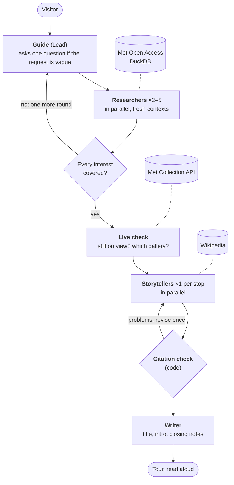

# Docent AI

## Your personal museum guide.

Every museum hides more than any visitor can find. Thousands of objects, hundreds of galleries, and
object labels written for experts leave most people wandering, missing the piece that would have
stopped them in their tracks.

- **The labels are written for experts.** They mention the "Ptolemaic Period" or "cartonnage",
  terms that aren't common knowledge and take some background to understand.
- **Google and chatbots don't know the collection.** The Met has **44,855** objects on view, and
  only **352** have their own Wikipedia article. For the rest, you'd need to read several sources
  to connect the dots.
- **Audio guides and tour guides are one-size-fits-all.** Every visitor's interests differ, yet
  everyone gets the same highlights instead of discovering the pieces that would truly speak to
  them.

**Docent AI gives every visitor a personal docent, starting with The Met in New York City, one of
the largest museums in the world, with about 5.7 million visitors a year.**

It searches all **44,855 objects on view** and plans a tour around your interests and your time,
ordering the stops into a walk that flows from one to the next instead of crisscrossing the
building. It explains every stop in a way you'll understand, meeting you where you are, and reads it aloud as
you walk. Behind it is a team of agents (Gemini 3.5 Flash on Vertex AI, OpenAI Agents SDK):

- **Guide.** Reads your request, asks a follow-up if it's too vague, and splits the museum into
  slices to research.
- **Researchers** (up to 5, in parallel). Each searches one slice of The Met's Open Access
  collection, loaded into DuckDB, and returns candidates with sourced evidence. If an interest
  isn't covered, the Guide sends them back for a second round.
- **Live check.** Before a stop makes the tour, The Met's Collection API confirms it's still on
  view and in which gallery, and the route is ordered so you don't double back.
- **Storytellers** (one per stop, in parallel). Each pulls from several sources: the object's Met
  record, its own or its artist's Wikipedia article (matched through Wikidata), and background
  articles on its culture, period and materials. It turns them into a 180–250-word story and one
  thing to look for.
- **Writer.** Writes the tour's title, introduction and closing notes.
- **Citation check** (code). Every fact carries a source tag. Code confirms each source was
  actually read in this run and that the names, places and numbers in a sentence appear in the
  source it cites. Anything that fails goes back for one revision.

The finished tour is read aloud with Gemini TTS, and a **Behind the scenes** panel streams every
agent's reasoning and tool call as it happens.

## At a glance

| | |
|---|---|
| **Live app** | https://docent-ai-41122305755.us-east1.run.app (Columbia sign-in) |
| **Course** | IEOR 4570 · Project 2: A Data Exploration Agent · Deep Research path |
| **Author** | sr4321 |
| **Data** | The Met Open Access (Nov 7, 2026 snapshot) · Met Collection API (live) · Wikidata · Wikipedia |
| **Stack** | Gemini 3.5 Flash on Vertex AI · OpenAI Agents SDK · DuckDB · FastAPI · Cloud Run |

## Who it's for

A curious visitor who is not an art historian: a first-timer with an afternoon, a parent with a
child who loves horses, someone who stops at an object label and wants to know *why it matters*.
They are standing in a gallery, on a phone, and want an answer they can trust and act on.

## How it works



**Agents and their jobs**

| Agent | Job | Tools |
|---|---|---|
| **Guide** (Lead) | Reads the request, asks one question if it is too vague, plans the research slices, picks the stops, handles label lookups and counting questions | `research`, `plan_route`, `write_tour`, `write_answer`, `tell_story`, `find_by_accession`, `find_by_title`, `run_sql`, `search_objects`, `gallery_summary`, `snapshot_info`, `get_object`, `get_wikipedia` |
| **Researcher 1…5** | Each searches one slice of the museum in a fresh context and returns candidates labeled *direct* or *related* to each interest, with sourced evidence | `run_sql`, `search_objects`, `get_object`, `gallery_summary`, `get_wikipedia` |
| **Storyteller 1…n** | One per stop, in parallel: plans what a newcomer won't know, reads background on Wikipedia, writes a 180–250 word story and a "look for". Each stop appears on the page as soon as its story is done; a Storyteller that passes 75 s is stopped and its stop uses the Researcher's cited facts | `get_wikipedia`, `search_wikipedia` |
| **Writer** | Writes only the tour's frame (title, introduction, what the data couldn't tell us) or a short answer | none: evidence only |
| **Citation check** (code) | Checks every `[met:…]`/`[wikipedia:…]` tag was actually read in this run, and that each cited sentence's names and numbers appear in the source it cites | — |

Every tool takes a required `why`: one sentence the agent writes for the visitor about why it is
making that call. That sentence is what the live panel shows.

### How it meets the Deep Research path

| Requirement | How |
|---|---|
| At least three agent shapes with different jobs | Guide (Lead), Researchers, Storytellers, Writer, plus a citation checker in code |
| Lead fans out to several Researchers in one turn, in parallel, fresh contexts | `research()` starts 2–5 Researchers with `asyncio.gather`, each a new `Runner.run` with only its slice |
| Lead goes back for more when findings leave a gap, up to a cap | A coverage check in code counts *direct* matches per interest; if one is missing, `plan_route` refuses and the Guide must run a second round (`MAX_RESEARCH_ROUNDS = 2`, `LEAD_MAX_TURNS = 20`). If it is still missing, the tour says so in its first sentence |
| Vague input requires clarification | "Show me cool stuff" gets one question about interests and time, and no tour |
| Accurately cited | Every fact carries `[met:<id>]`, `[wikipedia:<title>]` or `[data]`; a code check verifies sources were read and that cited names, places and numbers appear in the cited text, and sends problems back for one revision |

### Admitting what the data can't answer

The agent says so plainly for crowds, opening hours, loans and special exhibitions, objects not on
view, and anything a label says beyond the record. Tours open with "The Met has nothing on view that
directly matches *dinosaurs* (in its collection data of Nov 7, 2026)…" when an interest isn't
covered, and every tour ends with what the data could not tell us.

**Known limits**

- **Walking times** come from a simple model of the building (galleries grouped into wings and
  floors), not a floor plan.
- **Paraphrase:** the citation check catches names and numbers pinned on the wrong source, not a
  reworded over-claim.
- **Time-limited stops:** a stop whose Storyteller hits the 75 s limit shows the Researcher's facts
  instead of a full story, and those aren't re-checked.
- **The voice** is a generative model: it can stop early on a long paragraph. The page detects audio
  that is too short for its text and reads the rest again from one sentence before the cut.

## Data

| Source | What it gives | When |
|---|---|---|
| [The Met Open Access CSV](https://github.com/metmuseum/openaccess) (`MetObjects.csv`, 340 MB) | Every object's record; a gallery number means it is on view | Offline build; data as of **Nov 7, 2026** |
| [The Met Collection API](https://metmuseum.github.io/) | Image links (public-domain works only), and at tour time, whether each stop is still on view and where | Offline crawl (Nov 10) and live, per tour |
| [Wikidata](https://www.wikidata.org/) | Which English Wikipedia article each object and artist has (via the Met's Wikidata IDs) | Offline build |
| [Wikipedia](https://en.wikipedia.org/) REST and search APIs | Background articles the Storytellers read | Live |

The built database, `data/met.duckdb` (14 MB), is committed and ships with the deploy: 44,855
on-view objects, 30,429 with images, 352 with their own Wikipedia article and 5,189 whose artist
has one.

**Running it locally:**

```bash
cp .env.example .env              # set GOOGLE_CLOUD_PROJECT and WIKI_CONTACT
gcloud auth application-default login
uv run app.py                     # http://127.0.0.1:8010
```

**Rebuilding the database** (optional; the committed one is enough to run the app):

```bash
# 1. Download MetObjects.csv from github.com/metmuseum/openaccess into data/raw/
uv run build/build_db.py          # on-view objects -> data/met.duckdb
uv run build/fetch_images.py      # image links from the Met API (resumable, ~2 requests/s)
uv run build/merge_images.py      # copy them into the database
uv run build/wikidata_titles.py   # Wikipedia titles for objects and artists
```

## Sample queries

Each query was run in the app's UI (locally, Nov 18, 2026, data of Nov 7, 2026) and sent to the
same model, Gemini 3.5 Flash, with no tools and no system prompt (`eval/plain_model.py`, answers in
`eval/runs/plain.json`). Times are from sending the request to the finished tour; stops appear on the
page one by one before that.

### 1. Animals

> I have an hour and love animals, especially cats and horses. Plan me a tour.

**Expected:** about six on-view objects showing cats or horses, in walking order with galleries,
plus extras. **Source:** the `objects` table, 726 objects tagged Cats or Horses
(`list_contains(tags, 'Cats') OR list_contains(tags, 'Horses')`), each stop checked live with the
Met Collection API (`/public/collection/v1/objects/<id>`).

| Same model, no tools, no system prompt | Docent AI (90 s, first stop at 59 s, 15 agents, 76 tool calls) |
|---|---|
| Doesn't realize a museum is involved. Offers three options: a horse stable with barn cats, a cat café plus mounted police, or an "armchair safari" of YouTube videos and live cams. | **Cats and Horses through the Ages.** 1. *Figure of a Seated Cat*, Egyptian, 664–30 BCE, Gallery 130 · 2. *Armor for Man and Horse*, Italian, ca. 1570–90, Gallery 371 · 3. Bonheur, *The Horse Fair*, Gallery 812 · 4. Chardin, *The Silver Tureen*, Gallery 629 · 5. Carracci, *Two Children Teasing a Cat*, Gallery 637 · 6. Tang dynasty *Horse and female rider*, Gallery 207 · Extras: jade Chinese zodiac animals and a snuff bottle with eight horses (Gallery 207), a relief from Nagarjunakonda (Gallery 235). |

### 2. Monet

> How many works by Claude Monet are on view, and where? Plan me a tour of them.

**Expected:** **28** works in **5** galleries: 818 (10), 819 (11), 821 (4), 822 (2), 957 (1), and a
tour through them. **Source:** the `objects` table:
`SELECT gallery, count(*) FROM objects WHERE artist ILIKE '%Claude Monet%' GROUP BY gallery`.

| Same model, no tools, no system prompt | Docent AI (100 s, first stop at 58 s, 12 agents, 66 tool calls) |
|---|---|
| Plans a four-day trip through Paris, Giverny and Normandy, plus a New York and Boston tour. For The Met it guesses "typically 30+ works" and gives no galleries. | **Claude Monet: Capturing Shifting Light and Nature.** "There are twenty-eight works by Monet on view." 1. *Houses on the Achterzaan*, Gallery 957 · 2. *Garden at Sainte-Adresse* and 3. *La Grenouillère*, Gallery 818 · 4. *Bridge over a Pond of Water Lilies* and 5. *Rouen Cathedral: The Portal (Sunlight)*, Gallery 819 · 6. *Poppy Fields near Argenteuil*, Gallery 821 · 7. *Water Lilies* and 8. *The Path through the Irises*, Gallery 822 · Extras: *Camille Monet on a Garden Bench* (821), *Haystacks (Effect of Snow and Sun)* (819). |

### 3. Ancient Egypt

> It's my first time at The Met and I've always been fascinated by ancient Egypt. Can you show me the
> highlights in about an hour?

**Expected:** Egyptian Art highlights on view, in walking order. **Source:** the `objects` table,
101 Egyptian Art highlights in 26 galleries (`department = 'Egyptian Art' AND is_highlight`), each
stop checked live.

| Same model, no tools, no system prompt | Docent AI (128 s, first stop at 52 s, 15 agents, 80 tool calls) |
|---|---|
| A strong answer: five famous pieces (Tomb of Perneb, Gallery 100; Meketre models, 105; "William" the hippo, 111; Hatshepsut statues, 115; Temple of Dendur, 131), and the galleries match the data. But nothing is checked against what's on view today, and nothing is sourced. | **Ancient Egypt: Guardians, Gods, and Afterlives.** 1. *Hippopotamus ("William")*, Gallery 111 · 2. *Coffin of Khnumnakht*, Gallery 112 · 3. *Outer Coffin of the Chantress of Amun-Re Henettawy*, Gallery 126 · 4. *Sphinx of Hatshepsut* and 5. *The Temple of Dendur*, Gallery 131 · 6. *Mummy Mask of a Woman*, Gallery 133 · Extras: a cat statuette made to hold a mummified cat (134), Sakhmet (131), Thutmose III (118). One stop hit the 75 s limit and used the Researcher's facts. |

### 4. Greek and Roman myths

> Can you plan a 45-minute tour of Greek and Roman gods and heroes?

**Expected:** about five on-view objects showing gods and heroes. **Source:** the `objects` table,
Greek and Roman Art objects tagged with gods and heroes (e.g. Athena, 83; Dionysus, 81;
Herakles, 80), each stop checked live.

| Same model, no tools, no system prompt | Docent AI (102 s, first stop at 48 s, 15 agents, 88 tool calls) |
|---|---|
| A generic script for "a museum gallery (such as … the Met, the British Museum, or the Louvre)" with "ideal artifacts" to look for, like a bearded Zeus, and advice to check beforehand which statues are actually on display. Names no real objects. | **Gods, Heroes, and Monsters of the Ancient World.** 1. *Bronze man and centaur*, Greek, ca. 750 BCE, Gallery 151 · 2. *Marble statue of a wounded Amazon*, Gallery 153 · 3. "Hope Dionysos" and 4. *Marble statue of a youthful Hercules*, Gallery 162 · 5. Etruscan *Bronze chariot inlaid with ivory*, Gallery 170 · Extras: Herakles and Athena statuettes (171), *Eros sleeping* (164), a column-krater (160). |

### 5. Chinese art

> I'd love to spend 90 minutes with Chinese art, especially ceramics and landscape paintings.

**Expected:** Chinese ceramics and landscape paintings on view, in walking order. **Source:** the
`objects` table, 343 Chinese ceramics and 28 paintings on view in Asian Art, each stop checked live.

| Same model, no tools, no system prompt | Docent AI (107 s, first stop at 49 s, 15 agents, 91 tool calls) |
|---|---|
| A 90-minute session at home looking up images online, pointing to works in Taipei and the British Museum. Mentions The Met's Astor Court only as a place to sit. | **Clay and Canvas: Landscapes and Ceramics of China.** 1. Kangxi blue-and-white *Incense burner with figures in landscape*, Gallery 211 · 2. Wei Zhike, *Landscape of the four seasons*, and 3. Wu Bin, *Azure Cliff with Red Maples*, Gallery 210 · 4. Liao dynasty *Arhat (Luohan)*, Gallery 208 · 5. Ming *Jar*, Gallery 202 · 6. *Jar with Cover*, Gallery 200 · Extras: a Kangxi vase (200), a Yuan blue-and-white plate (204), a tile from Nanjing's "Porcelain Pagoda" (210). |

The no-tools model isn't wrong to hedge: it can't know what is on view. Where it does know the
museum well (ancient Egypt), it still can't check that a piece is on view today or cite where a fact
comes from. The same model, given the data and made to cite it, answers exactly and says when it
can't.
