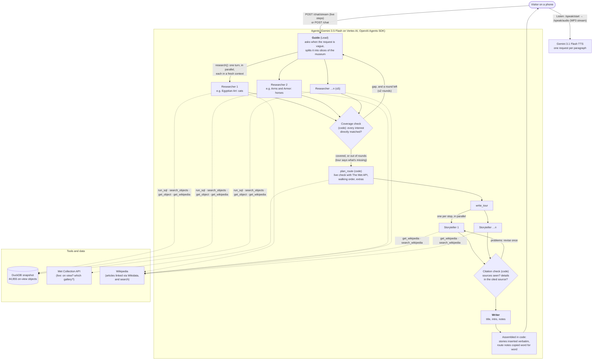

# Docent AI

**A museum docent in your pocket for The Met Fifth Avenue.** Tell it what you love and how long you
have, and it plans a walking tour of what is on view today, with a picture, a plain-language story
and a "look for" for every stop, read aloud as you walk. Photograph a wall label and it tells you
what you are looking at. Ask the collection a question and it answers from the data, with every fact
linked to its source.

**Live:** [docent-ai-41122305755.us-east1.run.app](https://docent-ai-41122305755.us-east1.run.app) · IEOR 4570 Project 2 · Deep Research path · `sr4321`

---

## The problem

The Met is one of the largest museums in the world, and a visit is easy to waste.

| What a visitor runs into | In numbers (from this project's data) |
|---|---|
| **Too much to choose from.** No one can see it all, and there is no way to ask "what here is for me?" | **44,855** objects on view in **421** galleries across **19** departments |
| **Labels assume you already know.** "Ptolemaic Period", "barding", "cartonnage", "Ikshvaku": the words that make a piece meaningful are the ones a newcomer doesn't know. | 1,074 highlights; only **352** objects have their own Wikipedia article |
| **Time is short and the building is a maze.** A good hour means a route that doesn't double back, and stops that are actually on view today. | Objects move and rotate off view; the public data is a snapshot |
| **A chatbot alone gets the museum wrong.** Ask a general model and it invents galleries, misses that a label number belongs to a different object, and gives counts it cannot know. | See the side-by-side answers below |

**Who it's for:** a curious visitor who is not an art historian: a first-timer with an afternoon, a
parent with a child who loves horses, someone who stops at a label and wants to know *why it
matters*. They are standing in a gallery, on a phone, and want an answer they can trust and act on.

## What it does

1. **Plans a tour** around your interests and time: a walking route ordered by gallery, about one
   stop per 10 minutes, plus extras that continue the walk if you have time left. Each stop is
   checked live with The Met's API.
2. **Explains a label:** type or photograph the accession number. It catches misread numbers by
   checking the title (1993.13 is a sculpture called *Filatrice*; the Van Gogh is 1993.132).
3. **Answers collection questions:** "How many Monets are on view, and where?", counted from the
   data, with the date of the data.
4. **Reads it aloud** in a natural voice (Gemini TTS, voice Charon), streamed paragraph by paragraph,
   with the sentence being read highlighted and a 1×/1.25×/1.5× speed control.
5. **Shows its work live:** a "Behind the scenes" panel streams every agent's thinking, each tool call
   with the reason the agent gave for it, and each result, with running agent and tool-call counts.

## How it works



**Agents and their jobs**

| Agent | Job | Tools |
|---|---|---|
| **Guide** (Lead) | Reads the request, asks one question if it is too vague, plans the research slices, picks the stops, handles label lookups and counting questions | `research`, `plan_route`, `write_tour`, `write_answer`, `tell_story`, `find_by_accession`, `find_by_title`, `run_sql`, `search_objects`, `gallery_summary`, `snapshot_info`, `get_object`, `get_wikipedia` |
| **Researcher 1…5** | Each searches one slice of the museum in a fresh context and returns candidates labeled *direct* or *related* to each interest, with sourced evidence | `run_sql`, `search_objects`, `get_object`, `gallery_summary`, `get_wikipedia` |
| **Storyteller 1…n** | One per stop, in parallel: plans what a newcomer won't know, reads background on Wikipedia, writes a 180–250 word story and a "look for" | `get_wikipedia`, `search_wikipedia` |
| **Writer** | Writes only the tour's frame (title, introduction, what the data couldn't tell us) or a short answer | none: evidence only |
| **Citation check** (code) | Checks every `[met:…]`/`[wikipedia:…]` tag was actually read in this run, and that each cited sentence's names and numbers appear in the source it cites | — |

Every tool takes a required `why`: one sentence the agent writes for the visitor about why it is
making that call. That sentence is what the live panel shows.

### How it meets the Deep Research path

| Requirement | How |
|---|---|
| At least three agent shapes with different jobs | Guide (Lead), Researchers, Storytellers, Writer, plus a citation checker in code |
| Lead fans out to several Researchers in one turn, in parallel, fresh contexts | `research()` starts 2–5 Researchers with `asyncio.gather`, each a new `Runner.run` with only its slice |
| Lead goes back for more when findings leave a gap, up to a cap | A coverage check in code counts *direct* matches per interest; if one is missing, `plan_route` refuses and the Guide must run a second round (`MAX_RESEARCH_ROUNDS = 2`, `LEAD_MAX_TURNS = 20`). If it is still missing, the tour says so in its first sentence |
| Vague input requires clarification | "Show me cool stuff" gets one question about interests and time, and no tour |
| Accurately cited | Every fact carries `[met:<id>]`, `[wikipedia:<title>]` or `[data]`; a code check verifies sources were read and that cited names, places and numbers appear in the cited text, and sends problems back for one revision |

### Admitting what the data can't answer

The agent says so plainly for crowds, opening hours, loans and special exhibitions, objects not on
view, and anything a label says beyond the record. Tours open with "The Met has nothing on view that
directly matches *dinosaurs* (in its collection data of Nov 7, 2026)…" when an interest isn't
covered, and every tour ends with what the data could not tell us.

## Data

| Source | What it gives | When |
|---|---|---|
| [The Met Open Access CSV](https://github.com/metmuseum/openaccess) (`MetObjects.csv`, 340 MB) | Every object's record; a gallery number means it is on view | Offline build; data as of **Nov 7, 2026** |
| [The Met Collection API](https://metmuseum.github.io/) | Image links (public-domain works only), and at tour time, whether each stop is still on view and where | Offline crawl (Nov 10) and live, per tour |
| [Wikidata](https://www.wikidata.org/) | Which English Wikipedia article each object and artist has (via the Met's Wikidata IDs) | Offline build |
| [Wikipedia](https://en.wikipedia.org/) REST and search APIs | Background articles the Storytellers read | Live |

The built database, `data/met.duckdb` (14 MB), is committed and ships with the deploy: 44,855
on-view objects, 30,429 with images, 352 with their own Wikipedia article and 5,189 whose artist
has one.

**Rebuilding it** (optional; the committed database is enough to run the app):

```bash
# 1. Download MetObjects.csv from github.com/metmuseum/openaccess into data/raw/
uv run build/build_db.py          # on-view objects -> data/met.duckdb
uv run build/fetch_images.py      # image links from the Met API (resumable, ~2 requests/s)
uv run build/merge_images.py      # copy them into the database
uv run build/wikidata_titles.py   # Wikipedia titles for objects and artists
```

## Sample queries

Each query was run against the agent and against the same model (Gemini 3.5 Flash) with no tools
and no system prompt.

### 1. A tour: "I have an hour and love animals, especially cats and horses. Plan me a tour."

**Expected:** a walking route of about six on-view objects that show cats or horses, about one per
10 minutes, in walking order, each with its gallery, plus extras. **Source:** the `objects` table
(`tags` and departments), each stop checked live against the Met Collection API
(`/public/collection/v1/objects/<id>`), stories from the Met record and Wikipedia.

| Same model, no tools, no system prompt | Docent AI (live, 245 s, 17 agents, 103 tool calls) |
|---|---|
| Doesn't know there is a museum involved. Offers a "virtual Barn Buddies tour" of YouTube videos (wild mustangs in Colorado, a kitten live cam, the Budweiser Clydesdales) or a cat café near you. | **Cats and Horses in Art.** 1. *Figure of a Seated Cat*, Egyptian, 664–30 BCE, Gallery 130 · 2. *Aquamanile in the Form of a Horse*, Nuremberg, ca. 1400, Gallery 306 · 3. Kemeys, *Panther and Cubs*, Gallery 700 · 4. Remington, *The Broncho Buster*, Gallery 765 · 5. Bonheur, *The Horse Fair*, Gallery 812 · 6. Goya, *Manuel Osorio Manrique de Zuñiga* (three cats watching a magpie), Gallery 641 · Extras: Carracci, *Two Children Teasing a Cat*, Gallery 637; Tang dynasty *Horse*, Gallery 207. All 8 checked on view live. Each stop has a 180–250 word cited story and a "look for". |

Behind it: the first research round (4 Researchers in parallel) left a gap, so the Guide went back
for a second round of 3 more (horse armor, American bronzes, medieval metalwork) before planning
the route. "Before you go" lists what was left out to avoid doubling back.

### 2. A label: `The label says 1993.13, "Wheat Field with Cypresses". What is it?`

**Expected:** the number is misread. 1993.13 is *Filatrice*, a sculpture by Henry Kirke Brown in
Gallery 736 (object 14309); *Wheat Field with Cypresses* by Vincent van Gogh (1889) is **1993.132**,
in **Gallery 822** (object 436535). **Source:** the `objects` table via `find_by_accession`
(accession number, then the title and artist as a check).

| Same model, no tools, no system prompt | Docent AI (live, 131 s) |
|---|---|
| Names the right painting, but accepts the wrong number ("1993.13 (sometimes cataloged as 1993.133)"), never mentions *Filatrice*, gives no gallery, and adds an unsourced purchase price ("around $57 million"). | "The accession number 1993.13 is one character off from 1993.132, which is the actual number for the painting… 1993.13 actually belongs to a bronze sculpture called *Filatrice* by Henry Kirke Brown in Gallery 736." Then a story (Post-Impressionism, the Saint-Paul-de-Mausole asylum, each explained and cited), "Look for: the cypress trees and the wheat field", and what else is in **Gallery 822**: Van Gogh's *Women Picking Olives*, *La Berceuse*, *Shoes*, *Roses*, *Olive Trees* and two Gauguins. |

### 3. A count: "How many works by Claude Monet are on view, and where?"

**Expected:** **28** works in **5** galleries: 818 (10), 819 (11), 821 (4), 822 (2), 957 (1), as of
the data of Nov 7, 2026. **Source:** the `objects` table:
`SELECT gallery, count(*) FROM objects WHERE artist ILIKE '%Claude Monet%' GROUP BY gallery`.

| Same model, no tools, no system prompt | Docent AI (live, 31 s) |
|---|---|
| Says it is "impossible to give an exact, real-time number" and lists museums around the world (Marmottan, Orsay, Orangerie, Art Institute of Chicago…) with estimates. | "In The Met's collection data of Nov 7, 2026, there are 28 works by Claude Monet on view. You can find ten of these works in Gallery 818, eleven in Gallery 819, four in Gallery 821, two in Gallery 822, and one in Gallery 957." |

The no-tools model is not wrong to hedge: it cannot know what is on view. That is the point of the
agent: the same model, given the data and made to cite it, answers exactly and says when it can't.

## Running it

```bash
cp .env.example .env              # set GOOGLE_CLOUD_PROJECT and WIKI_CONTACT
gcloud auth application-default login
uv run app.py                     # http://127.0.0.1:8010
```

`POST /chat` keeps Project 1's shape, `{response, session_id, tool_calls}`, with an `agent` field on
every tool call (including the Researchers', Storytellers' and the citation checks').
`POST /chat/stream` runs the same turn and sends each step as a server-sent event.

**Deploy:** Cloud Run, us-east1, continuous deploy from this repo's `main` (Google Cloud buildpacks,
`Procfile`: `python app.py`). Request timeout 15 minutes; one instance, since conversations and
audio are kept in memory.

## Known limits

- **Speed:** a one-hour tour takes 2–4 minutes on Cloud Run (245 s above, with two research rounds);
  a 90-minute tour can come close to 5. The live panel shows the work meanwhile.
- **Walking times** come from a simple model of the building (galleries grouped into wings and
  floors), not a floor plan.
- **Paraphrase:** the citation check catches names and numbers pinned on the wrong source, not a
  reworded over-claim.
- **The voice** is a generative model: it can stop early on a long paragraph. The page detects audio
  that is too short for its text and reads the rest again from one sentence before the cut.
