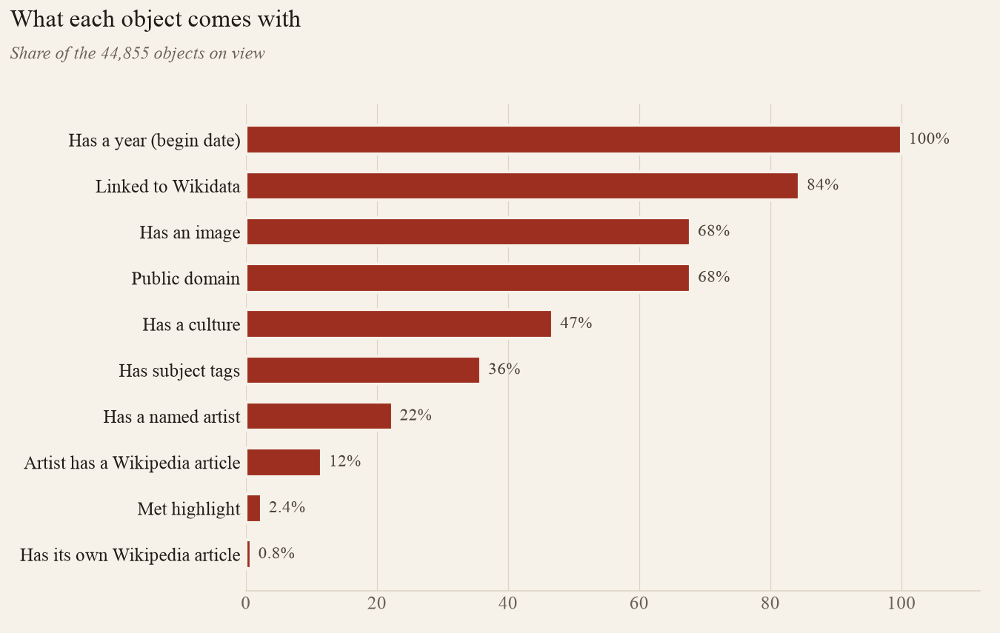
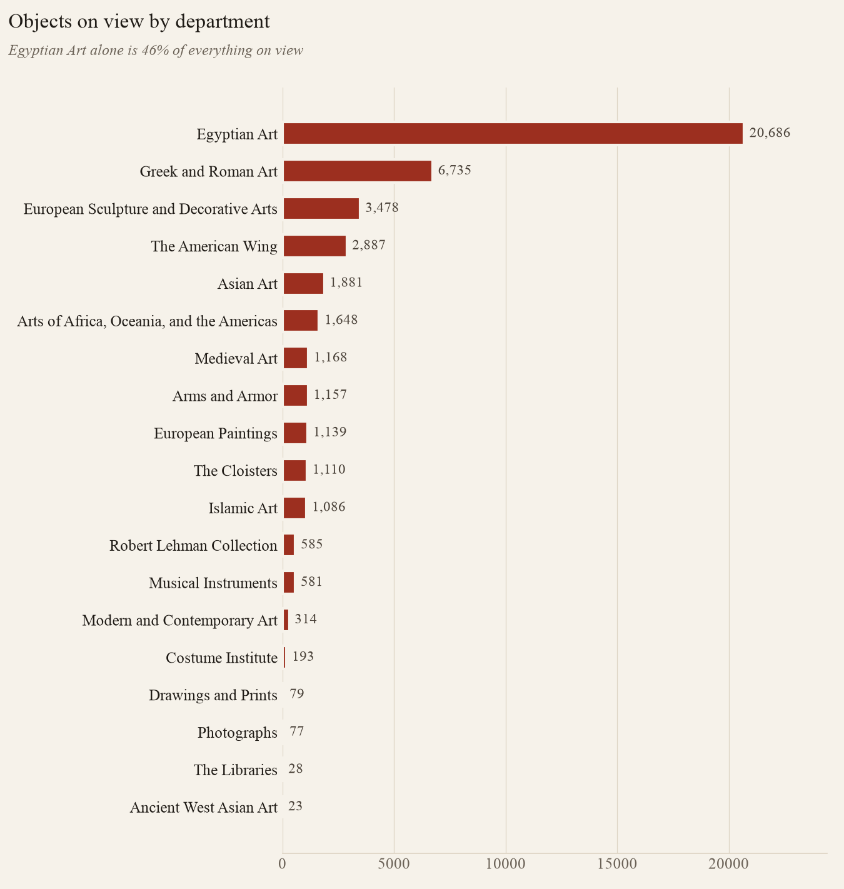
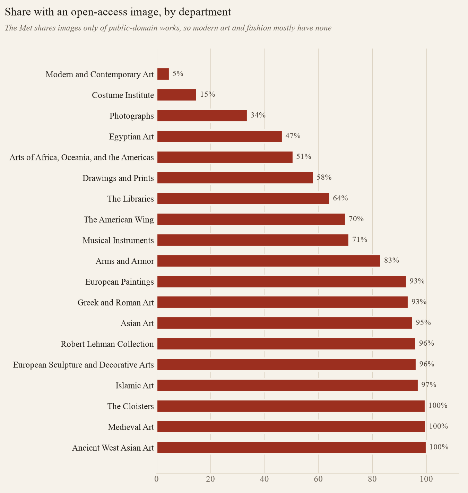
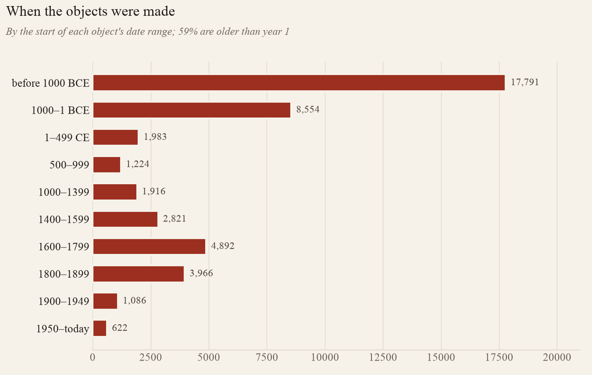
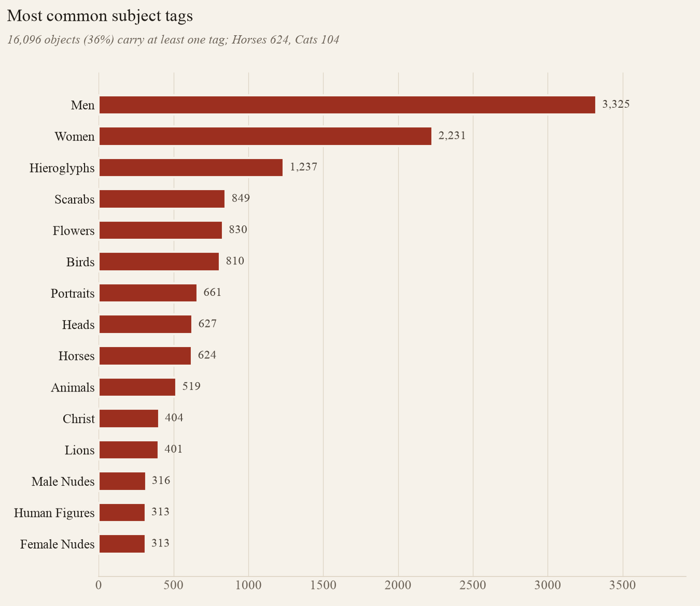
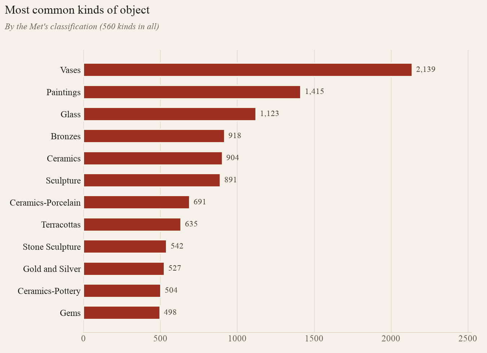

# The data behind Docent AI

What is in `data/met.duckdb`: the shape of the data, how complete it is, and what that means for the
agents. Every number here is computed from the database itself.

**Snapshot:** The Met's Open Access export of **Nov 7, 2026**, built Nov 10; images checked against
the Met API on Nov 10. The database is 14 MB and has three tables: `objects` (one row per object on
view, 37 columns), `wiki` (Wikidata ID → English Wikipedia title), and `build_info`.

## At a glance

| | |
|---|---|
| **44,855** | objects on view |
| **421** | galleries |
| **19** | departments |
| **4,259** | named artists and makers |
| **2,211** | cultures |
| **560** | kinds of object (classifications) |
| **30,429** | objects with an open-access image (68%) |
| **1,074** | Met highlights |
| **352** | objects with their own Wikipedia article (0.8%) |
| **5,189** | objects whose artist has a Wikipedia article (11.6%) |

## What each object comes with

- **Almost every object has a date**, but 221 have a blank date *text* and only their year fields.
  The app fills those in (e.g. Carracci's *Two Children Teasing a Cat* becomes "1587–88").
- **Only 22% have a named artist.** Most objects are by unknown makers, so stories lean on
  culture, period and material instead of biography.
- **Only 0.8% have their own Wikipedia article.** That is why the Storytellers don't look up the
  object itself: they search Wikipedia for its *background* (the Ptolemaic Kingdom, cartonnage,
  barding) and explain those terms.
- **84% are linked to Wikidata**, which is how the build finds the articles that do exist.

## Where the objects are

- **Egyptian Art is 46% of everything on view** (20,686 objects), and Greek and Roman Art another
  15%. A search over the whole collection is dominated by scarabs, amulets and vases. That is why
  the Guide splits a request into slices by department and sends one Researcher to each: a tour
  about horses should not be ten Egyptian amulets.
- **Galleries vary enormously.** The median gallery holds 28 objects; a quarter hold 14 or fewer;
  gallery 122 (Egyptian Art) holds 4,526. A tour picks one strong object per stop, not a gallery.

| Most crowded galleries | Objects | Department |
|---|---|---|
| 122 | 4,526 | Egyptian Art |
| 171 | 3,325 | Greek and Roman Art |
| 130 | 2,998 | Egyptian Art |
| 109 | 2,879 | Egyptian Art |
| 120 | 2,326 | Egyptian Art |

## Pictures

The Met publishes images only of public-domain works. Ancient and medieval art is almost fully
pictured; **Modern and Contemporary Art has images for 15 of 314 objects**, and the Costume
Institute for 29 of 193. On a tour, a stop without an image says so instead of showing a blank.

## When they were made

**59% of the objects on view are older than year 1**, and 40% older than 1000 BCE. The span runs
from **Acheulean stone bifaces, 700,000–200,000 BCE** (gallery 370) to **2026** fashion by Michaela
Stark and the House of Dior (gallery 099).

## What they show

Subject tags come from the Met and cover 36% of objects. They are the most reliable way to find
animals and themes: **624 objects are tagged Horses and 104 Cats**, which is why Researchers start
with a tag query (`list_contains(tags, 'Horses')`) before keyword search.

**Most-represented makers** (named): Louis C. Tiffany (163), Edgar Degas (104), Sèvres Manufactory
(99), Artists of Mariwai Village (98), Meissen Manufactory (90), Nina de Garis Davies (59).

**Most common materials:** faience (4,510), terracotta (2,856), glass (1,790), bronze (1,605),
painted limestone (1,218), oil on canvas (1,014).

## Is it still on view?

When the images were fetched (Nov 10), the Met API reported **44,853 of 44,855 objects still on
view**. Objects do move, though, so every tour checks its stops live again at the moment it is
planned, and the page shows the time of that check.

## What this means for the agent

| Finding | Design choice |
|---|---|
| Egyptian Art dominates | Research is split into department slices, one Researcher each, in parallel |
| Tags are the best way to find a subject | Researchers query tags first, then keywords and synonyms |
| 0.8% of objects have their own article | Storytellers read background articles on culture, period, material and subject |
| 78% have no named artist | Stories explain culture and period instead of biography |
| 32% have no image | Cards say "no open-access image" rather than show nothing |
| The snapshot ages | Every tour stop is checked live with the Met API |
